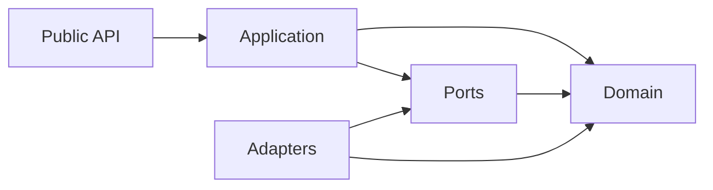

# Rust project design

Status: Cargo scaffold created following the owner's request. The structure is in place; domain behavior, execution facilities, and native bindings are future work. The [research decisions](decisions.md) still govern their individual gates.

## Structure and dependency direction

Use a small **ports-and-adapters architecture**, implemented with Rust modules, encapsulated structs/enums, focused traits, and explicit composition. A single library crate keeps navigation and builds simple while the first responsibilities take shape. Split crates later only when independent dependencies, packaging, or ownership justify it.

```text
kopos/
├── Cargo.toml                 Library package; Rust 2024; publishing disabled
├── Cargo.lock                Reproducible dependency resolution
├── src/
│   ├── lib.rs                Crate boundary and module declarations
│   ├── api/mod.rs            Public facade and reviewed consumer types
│   ├── domain/mod.rs         Host-independent values and invariants
│   ├── application/mod.rs    Use cases and ownership coordination
│   ├── ports/mod.rs          Focused traits for external capabilities
│   └── adapters/mod.rs       Concrete host/native integrations
└── docs/
    ├── design.md             This design and coding guidance
    ├── decisions.md          Decision ledger
    ├── roadmap.md            Bounded implementation gates
    └── research/             Architecture and ownership reference
```

The intended dependency direction is:



Composition at the crate boundary connects concrete adapters to application code. Application code does not import concrete adapters. Domain code knows nothing about host bindings or orchestration. These dependency rules are conventions for this single crate, not compiler-enforced architectural guarantees.

Only `api` is a public module today; its surface is empty. Keep other modules private and re-export individual types only after their public contracts are reviewed. The module files contain responsibility documentation, without speculative trait methods or placeholder runtime behavior. Add subfolders when implemented features need them.

## Applying OOP and SOLID in Rust

Rust supports encapsulation through visibility and methods on structs/enums, and polymorphism through traits. It favors composition for sharing behavior. The official Rust Book describes [object-oriented characteristics](https://doc.rust-lang.org/book/ch18-01-what-is-oo.html) and [trait-based polymorphism](https://doc.rust-lang.org/book/ch18-02-trait-objects.html).

| Principle             | Concrete design rule                                                                                                                                                                                               |
| --------------------- | ------------------------------------------------------------------------------------------------------------------------------------------------------------------------------------------------------------------ |
| Single responsibility | Each type owns one coherent invariant or lifecycle. Keep task settlement, physical execution, result ownership, and host conversion under distinct authorities when implemented.                                   |
| Open/closed           | Add a new adapter behind an existing meaningful port when its contract fits. Avoid conditionals for host-specific implementation details inside domain rules.                                                      |
| Liskov substitution   | Every implementation must uphold the port's ownership, error, cancellation, and completion guarantees. Report unsupported capabilities before admission instead of pretending implementations are interchangeable. |
| Interface segregation | Introduce small traits around capabilities actually required by a consumer. Avoid one backend trait that forces every implementation to support unrelated scheduling, loading, compilation, and graphics behavior. |
| Dependency inversion  | Application code describes the capability it needs through a port; adapters implement it. Pass dependencies explicitly to constructors/functions.                                                                  |

Use concrete types for a single implementation, generics when compile-time substitution is useful, and `dyn Trait` when runtime selection is required. Choose enums for a deliberately closed set of states or alternatives. A trait per struct, a base-class hierarchy, or a dependency-injection framework is unnecessary.

Private fields and validated constructors protect invariants. `Result<T, E>` carries expected failures; enums describe meaningful states. Ownership and borrowing determine resource lifetimes; introduce shared synchronization only when actual concurrent owners require it. Avoid a blanket `Arc<Mutex<_>>` around the design.

Any future executor boundary must preserve the [execution and ownership contract](research/execution-and-ownership-contract.md). Neither implementing a trait nor applying SOLID proves safe cancellation, physical completion, or access to a JavaScript heap.

## Local development

The package is a library because the research targets reusable computation facilities. A CLI can become a separate target or crate when the optional preparation workflow is justified. No third-party dependencies, async runtime, thread pool, FFI layer, or worker implementation is selected by this scaffold.

```bash
rtk cargo fmt --check
rtk cargo clippy --offline --all-targets -- -D warnings
rtk cargo test --offline
```

There are no behavioral tests yet because there is no behavior. The generated Cargo arithmetic example was removed. Add meaningful tests alongside the first implementation unit in the [roadmap](roadmap.md), rather than tests that merely assert the folder layout.
