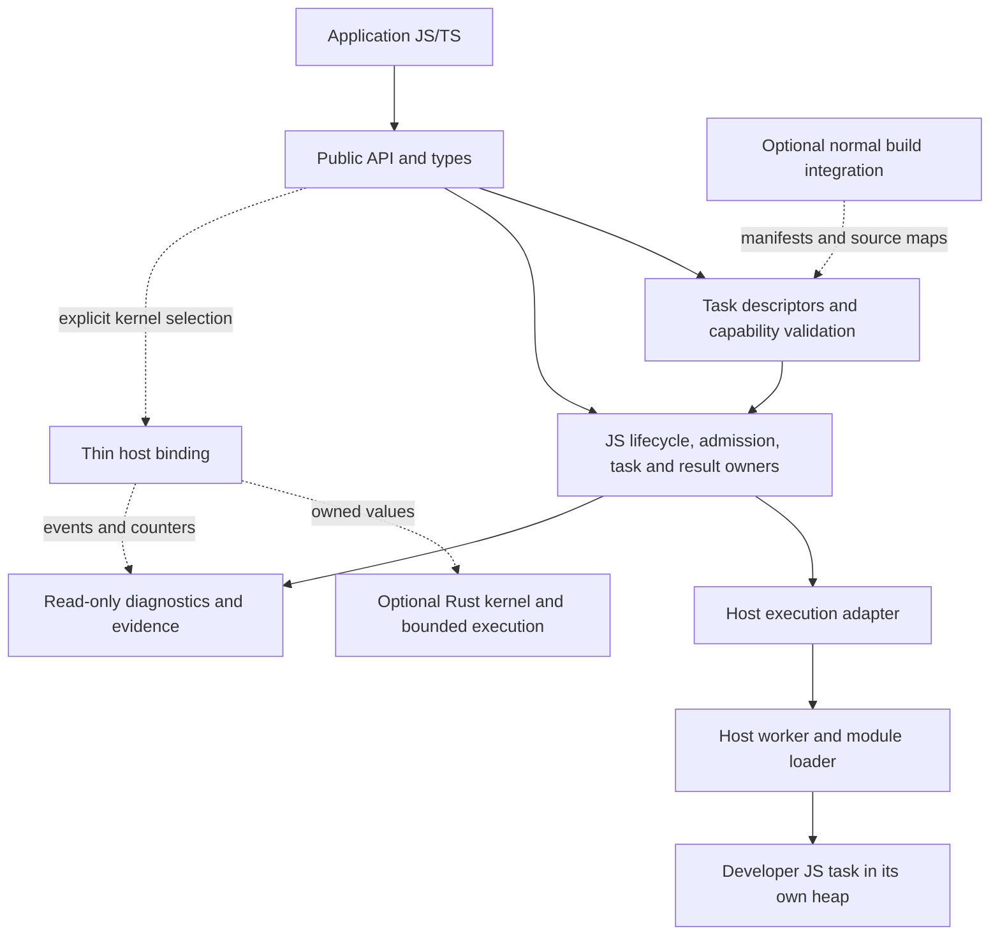

# Architecture assessment

Research date: **2026-10-21**. Status: **proposed architecture; no implementation or new runtime qualification**. [Navigation](../../README.md) · [Contract](execution-and-ownership-contract.md) · [Roadmap](../roadmap.md) · [Decisions](../decisions.md).

## Recommendation and its limits

Retain the existing execution model for general JS/TS: registered module exports execute in separate heaps supplied by the application host. Investigate a small host boundary before moving scheduling into Rust. Explore Rust as an optional provider of selected computation kernels, with independent packaging and lifecycle qualification. Do not build a general JS compiler, embedded engine, new application host, or background service now.

This recommendation is an inference from the source and primary evidence below. It does not establish that Bun already runs PJS correctly, that native kernels will be faster end to end, or that developers should rewrite tasks in Rust. The strongest counterargument is that host adapters retain host differences in module loading, termination, diagnostics, and memory. A dedicated engine or process could provide a more consistent execution environment and support more computations than a kernel catalogue. That consistency carries engine maintenance, distribution, startup, debugging, and host-API responsibilities; reopen it only for a concrete workload that adapters cannot serve.

## Requirements and desired journey

**Owner requirements:** applications continue using ordinary JS/TS; Rust is preferred for investigation, not mandated for application developers. Optional heavy components must remain optional. Installation, startup, memory, debugging, and deployment count as product performance. No special compiler, engine download, service, or application host is justified by naming it differently. v1.0 source, release plans, qualification tooling, and immutable baselines remain outside this work. `.pjs` preparation is a hypothesis, not an accepted format.

**Proposed journey:** a developer exports a JS/TS computation from a normal module, registers it through the existing style of typed handle, and builds TypeScript using their usual tooling. A target validator identifies unavailable dependencies before deployment where possible. Their chosen supported host loads the task in a host worker. They submit data, observe errors and cancellation through documented contracts, and explicitly shut down. A separately installed kernel package may accelerate an explicitly selected operation through a JS wrapper; general task registration continues to mean JS execution. Unsupported native capabilities are reported before admission, or a developer-selected JS implementation is used before any execution starts. No retry of possibly executed work is called a fallback.

| Outcome               | Future observable measure                                                                                    |
| --------------------- | ------------------------------------------------------------------------------------------------------------ |
| Responsiveness        | Host event-loop delay; later browser frame intervals and input latency during computation                    |
| Time to useful result | Submission through first usable output, and separately through all required output                           |
| Throughput            | Correct useful work completed per wall-clock interval under a declared concurrency limit                     |
| Cold startup          | Process launch, package import, optional binary load, worker imports, readiness, first result                |
| Installation cost     | Compressed download bytes, installed bytes, dependency count, clean/offline installation behavior            |
| Steady-state memory   | Quiescent and busy process RSS, isolate heap/external memory, native allocations, retained inputs/results    |
| Developer experience  | Steps to register/build/deploy, actionable unsupported-dependency errors, usable task stacks and source maps |

Budget calibration and acceptance are specified in the [roadmap](../roadmap.md#future-experiment-specification); no measured baseline exists for Kopos. PJS should leave network caching, scene design, draw-call reduction, asset compression policy, DOM updates, rendering, and GPU scheduling to application/framework/graphics tooling. It can coordinate eligible CPU preparation without claiming to accelerate arbitrary application behavior.

## Inspected baseline and isolation

The shell instruction supplied by the owner refers to `/home/miskovy/.codex/RTK.md`, which requires shell commands to use `rtk`. No additional `AGENTS.md` was found in the PJS source tree or applicable parent directories. Discovery preceded source analysis; subsequent shell commands used RTK. No reset, checkout, fetch into PJS, merge, rebase, or source mutation was performed.

| Evidence                            | Exact observation                                                                                                                                                                                                                                                                                                                                           |
| ----------------------------------- | ----------------------------------------------------------------------------------------------------------------------------------------------------------------------------------------------------------------------------------------------------------------------------------------------------------------------------------------------------------- |
| Public main, queried through GitHub | `72335494704a6251c26505226c4f2575424ab190`, commit date `2026-10-19T08:34:18Z`; [R3 merge](https://github.com/Miskovy/parallel-javascript/commit/72335494704a6251c26505226c4f2575424ab190)                                                                                                                                                                  |
| Local PJS checkout                  | Clean tracked/untracked status; branch `runtime/r3-memory-resource-lifecycle`, HEAD `54bb3cf2201b5ec7aad94e9871139917f357f112`, commit date `2026-10-19T11:20:33+03:00`                                                                                                                                                                                     |
| Local refs                          | `origin/main` already at public main; local `main` still `6d9f97457c6490c985bf1023d918fff72a428c0e` (R2 merge). These refs were not updated                                                                                                                                                                                                                 |
| Source identity equivalence         | Local HEAD and public main have identical tree `9c85596e1cda0666d6d3f5d31270e29b8dd459e9`; `git diff` between them was empty. Thus local file reads represent merged main, despite differing commit identities                                                                                                                                              |
| Relevant PRs                        | [#17](https://github.com/Miskovy/parallel-javascript/pull/17) merged `2026-10-19T08:34:19Z`; [#16](https://github.com/Miskovy/parallel-javascript/pull/16) merged `2026-10-11T19:59:14Z`; [#15](https://github.com/Miskovy/parallel-javascript/pull/15) merged `2026-10-11T08:08:11Z`. Query returned 16 PRs, all closed and merged; no open S1 PR observed |
| Historical S1 candidate             | Owner supplied `f93fb9cb249a54ee625a19a20b5a6d7f7d68647f` on `refactor/v1-runtime-api-boundaries`. Local object lookup failed; branch absent locally and in returned remote branches; GitHub commit lookup returned 422, no commit found. No S1 report found. It was **not inspected**, and its contents/merge status must not be inferred                  |
| Package declarations                | Workspace version `1.0.0-rc.4`; Node range `^22.13.0                                                                                                                                                                                                                                                                                                        |     | ^24.0.0`. This does not mean the currently published RC4 contains later R1/R2/R3 development |
| Kopos                               | Initially no project documents or usable Git repository; existing `.idea` preserved. Remote metadata reports size 0/default branch main. Git initialization blocked by read-only `.git`; see [README](../../README.md#local-git-setup)                                                                                                                      |

Branch history was inspected through R3, R2, R1, registry convergence, and RC4. Local working-tree cleanliness excludes ignored artifacts; no claim is made to have audited prior evidence archives. Source reports were read, but their earlier test counts, timings, and CI outcomes were not rerun or independently certified. The older R1 engineering log describes a historical defect; current `worker.ts` and dispatcher completion paths, rather than that obsolete defect description, control this assessment.

### Current source responsibility map

All links in this table pin the inspected merged SHA. Names describe **existing internal owners**, not proposed public APIs.

| Owner / inspected files                                                                                                                                                                                                                                                                                                                                                                                                                                        | Behavior and portability implications                                                                                                                                                                                                                                                                |
| -------------------------------------------------------------------------------------------------------------------------------------------------------------------------------------------------------------------------------------------------------------------------------------------------------------------------------------------------------------------------------------------------------------------------------------------------------------- | ---------------------------------------------------------------------------------------------------------------------------------------------------------------------------------------------------------------------------------------------------------------------------------------------------- |
| [Registry](https://github.com/Miskovy/parallel-javascript/blob/72335494704a6251c26505226c4f2575424ab190/packages/runtime/src/tasks/registry.ts), [composition](https://github.com/Miskovy/parallel-javascript/blob/72335494704a6251c26505226c4f2575424ab190/packages/runtime/src/runtime.ts)                                                                                                                                                                   | Frozen handles map to `file:` module URLs and exports; runtime snapshots descriptors. Facade owns lifecycle and guarded progress loop. Worker count uses `node:os.availableParallelism`                                                                                                              |
| [Bootstrap](https://github.com/Miskovy/parallel-javascript/blob/72335494704a6251c26505226c4f2575424ab190/packages/runtime/src/workers/bootstrap.ts), [protocol](https://github.com/Miskovy/parallel-javascript/blob/72335494704a6251c26505226c4f2575424ab190/packages/runtime/src/workers/protocol.ts)                                                                                                                                                         | Each worker imports every registered module and verifies callable exports before ready. Executes/awaits the export. Protocol v2 validates start/final response, batches, binary declarations, and serialized errors. Uses `parentPort`, `workerData`, and optional `process.hrtime.bigint` profiling |
| [Dispatcher](https://github.com/Miskovy/parallel-javascript/blob/72335494704a6251c26505226c4f2575424ab190/packages/runtime/src/dispatch/dispatcher.ts), [FIFO](https://github.com/Miskovy/parallel-javascript/blob/72335494704a6251c26505226c4f2575424ab190/packages/runtime/src/scheduler/fifo.ts)                                                                                                                                                            | Claims worker/queue capacity before reentrant application code; weighted FIFO counts logical tasks in batches. Posting failure rolls back dispatch claims; `finally` clears host input/transfer intent. Scheduling is already separate from execution                                                |
| [Task coordinator](https://github.com/Miskovy/parallel-javascript/blob/72335494704a6251c26505226c4f2575424ab190/packages/runtime/src/tasks/coordinator.ts)                                                                                                                                                                                                                                                                                                     | Owns logical records, timers, abort listeners, transfer claims, once-only settlement and error translation. Uses `node:crypto.randomUUID`; caller settlement can precede physical end                                                                                                                |
| [Range coordinator](https://github.com/Miskovy/parallel-javascript/blob/72335494704a6251c26505226c4f2575424ab190/packages/runtime/src/partition/coordinator.ts), [operation](https://github.com/Miskovy/parallel-javascript/blob/72335494704a6251c26505226c4f2575424ab190/packages/runtime/src/partition/operation.ts)                                                                                                                                         | Own parent lifecycle, lazy bounded production, host factories, collect/discard/stream/map modes. `isMainThread` prevents nested partitioning, `setImmediate` yields production, `AsyncResource` preserves host async context. Factories stay on the host                                             |
| [Result credits](https://github.com/Miskovy/parallel-javascript/blob/72335494704a6251c26505226c4f2575424ab190/packages/runtime/src/results/credit.ts), [stream](https://github.com/Miskovy/parallel-javascript/blob/72335494704a6251c26505226c4f2575424ab190/packages/runtime/src/partition/stream.ts)                                                                                                                                                         | Per-item reservations survive active caller cancellation. Deliverable maximum-size success refunds slack; actual credit lasts until delivery. Stream is single-consumer, completion-order, eager; close/failure clears buffered results. Debug invariant flag reads `process.env`                    |
| [Worker](https://github.com/Miskovy/parallel-javascript/blob/72335494704a6251c26505226c4f2575424ab190/packages/runtime/src/workers/worker.ts), [pool](https://github.com/Miskovy/parallel-javascript/blob/72335494704a6251c26505226c4f2575424ab190/packages/runtime/src/pool/pool.ts)                                                                                                                                                                          | Node Worker owns one correlated physical execution. Validated final result or exit ends occupancy. Lease failure initiates termination; replacement awaits old exit. Pool owns restart budget and repair promises; bootstrap failure is fatal without replay                                         |
| [Transfer](https://github.com/Miskovy/parallel-javascript/blob/72335494704a6251c26505226c4f2575424ab190/packages/runtime/src/tasks/transfer.ts), [shared input](https://github.com/Miskovy/parallel-javascript/blob/72335494704a6251c26505226c4f2575424ab190/packages/runtime/src/tasks/shared.ts), [binary inspection](https://github.com/Miskovy/parallel-javascript/blob/72335494704a6251c26505226c4f2575424ab190/packages/runtime/src/partition/binary.ts) | `node:util.types`, `isMarkedAsUntransferable`, and `Buffer.isBuffer` require semantic adapters. Transfer claims are isolate-local WeakMaps. Shared helper copies a visible slice; readonly is a usage contract, not enforced immutability                                                            |
| [Errors](https://github.com/Miskovy/parallel-javascript/blob/72335494704a6251c26505226c4f2575424ab190/packages/runtime/src/errors/index.ts), [telemetry](https://github.com/Miskovy/parallel-javascript/blob/72335494704a6251c26505226c4f2575424ab190/packages/runtime/src/telemetry/runtime.ts), [profiling](https://github.com/Miskovy/parallel-javascript/blob/72335494704a6251c26505226c4f2575424ab190/packages/runtime/src/telemetry/profile.ts)          | Typed errors retain task/worker/operation context and remote stacks. Stats project owners without acquiring their authority; stage profiling is internal and optional                                                                                                                                |

Architectural and ownership reports inspected: [architecture](https://github.com/Miskovy/parallel-javascript/blob/72335494704a6251c26505226c4f2575424ab190/docs/architecture.md), [ADR 0018](https://github.com/Miskovy/parallel-javascript/blob/72335494704a6251c26505226c4f2575424ab190/docs/adr/0018-runtime-core-decomposition.md), [ADR 0021](https://github.com/Miskovy/parallel-javascript/blob/72335494704a6251c26505226c4f2575424ab190/docs/adr/0021-physical-execution-containment.md), [memory ownership](https://github.com/Miskovy/parallel-javascript/blob/72335494704a6251c26505226c4f2575424ab190/docs/guide/memory-ownership.md), [lifecycle](https://github.com/Miskovy/parallel-javascript/blob/72335494704a6251c26505226c4f2575424ab190/docs/guide/lifecycle.md), [R2 model report](https://github.com/Miskovy/parallel-javascript/blob/72335494704a6251c26505226c4f2575424ab190/docs/research/r2-lifecycle-verification.md), and [R3 ownership inventory](https://github.com/Miskovy/parallel-javascript/blob/72335494704a6251c26505226c4f2575424ab190/docs/research/r3-memory-resource-qualification.md). Proposal/ADR intent was compared with implementation; an accepted upstream ADR does not accept any Kopos design.

## Six distinct portability problems

1. **Node executable requirement.** Current build/test scripts invoke `node`, and PJS declares Node support. A Bun application importing `node:*` uses Bun's implementation; the import does not launch Node. Tooling executable requirements and application runtime requirements must be assessed independently.
2. **Node-compatible APIs.** Worker events, exit confirmation, cloning/transfers, async context, scheduling continuations, UUIDs, buffer inspection, environment flags, and module URLs are concrete dependencies. An API existing under the same name does not establish behavioral equivalence.
3. **Engine internals.** Inspected PJS runtime uses public Node APIs, not V8 embedding internals. A V8-specific addon would add a new coupling. Node-API avoids direct V8 ABI dependence when used within its documented boundary; it does not standardize every host.
4. **Native scheduling and execution.** Rust may own native work queues and kernels. It still needs a mechanism that executes task code. Host JS functions cannot become parallel native computations merely by placing their handles on a Rust queue.
5. **Task/dependency portability.** A pure module may work across hosts; a module requiring Node filesystems, DOM, native addons, global state, or a particular resolver may not. Bundling can relocate imports but cannot supply missing semantics.
6. **Binary portability.** OS, CPU, libc/system ABI, minimum OS, instruction set, dynamic libraries, and binding version govern distribution. `.node` is a native addon container convention for compatible hosts, not a universal JavaScript extension format. SpiderMonkey is an engine; the embedding host supplies its native APIs. Browsers do not load `.node` addons.

The [Bun compatibility table](https://bun.sh/docs/runtime/nodejs-compat) observed on this date advertises Bun 1.4.3 and compares against Node 26. It reports ignored Worker resource limits, incomplete async hooks, and diagnostic gaps. In particular, it describes `AsyncResource`/`AsyncLocalStorage` as implemented, but several hook APIs as stubs and context propagation into Worker/MessagePort events as absent. These are project claims, not PJS test results. [Bun Node-API documentation](https://bun.sh/docs/runtime/node-api) says Bun implements Node-API and loads `.node` modules. [Worker compatibility source](https://github.com/oven-sh/bun/blob/2d6d4454f3fa3957dde2c669f3b2f69b2f0a5ea5/src/js/node/worker_threads.ts), pinned at `2d6d4454f3fa3957dde2c669f3b2f69b2f0a5ea5` (`2026-10-21T08:20:19Z`), contains transfer-marker functions, MessagePort forwarding, and termination handling. Their presence does not verify PJS's ordering and ownership invariants. Resource-limit differences are not necessarily blockers: current PJS does not configure that option. Async context and physical-exit behavior are directly relevant gates.

## Alternatives assessed

| Approach                                       | Actual executor / benefit hypothesis                                                                     | Costs and unresolved obligations                                                                                                                           | Recommendation and reopening condition                                                                                                                              |
| ---------------------------------------------- | -------------------------------------------------------------------------------------------------------- | ---------------------------------------------------------------------------------------------------------------------------------------------------------- | ------------------------------------------------------------------------------------------------------------------------------------------------------------------- |
| Existing JS with host adapters                 | Host engine in host workers; preserves ordinary task modules and existing developer tools                | Host-specific loading, diagnostics, transfer validation, termination, context; browser URLs require a deliberate registration extension                    | **Proposed default.** Qualify Node and one Bun release first. Revisit if required semantics cannot be supplied by a target host                                     |
| Selected Rust computations                     | Precompiled native kernels called through a JS wrapper; potential CPU/library and memory-layout benefits | Marshalling, binary distribution, native fault exposure, cancellation, kernel catalogue maintenance; does not execute arbitrary JS                         | **Proposed optional research branch.** Proceed only if a representative end-to-end workload repays these costs and JS usage remains natural                         |
| Rust executor plus supported JS/TS compilation | A compiler lowers an explicitly bounded language subset to native/Wasm code; Rust schedules it           | Semantic analysis, runtime helpers, allocation/GC if objects permitted, source maps, diagnostics, fallback rules, compiler maintenance                     | **Deferred subset; reject universal transparent compilation.** Reopen after a task corpus demonstrates useful coverage without asking users to adopt a new language |
| Rust embeds V8, SpiderMonkey, or QuickJS       | Separate engine heaps execute JS; Rust owns an embedding runtime                                         | Engine/build size, startup, jobs/promises, module resolver, host APIs, GC roots, debugger integration, security updates, interrupts and native-call limits | **Deferred.** Reopen for a named embedding customer or workload needing a stable execution environment unavailable from host workers                                |
| Separate execution process                     | OS process runs kernels or an engine; independent fault boundary and host bridge                         | Executable packaging, launch cost, IPC/backpressure, process supervision, orphan cleanup; browser cannot launch it                                         | **Deferred optional containment profile.** Reopen if native crash/blocked-call isolation is necessary and deployment permits a child process; no daemon by default  |

A Rust-owned OS thread cannot concurrently use the originating JS heap as if Rust ownership governed it. Engine handles, GC roots, context entry, and thread-affinity rules still apply. Node-API thread-safe functions enqueue notifications for execution on the owning JS environment's thread; they do not run that JS callback on the calling native thread. Creating an independent isolate creates another heap and another loading/data boundary. [Node-API](https://nodejs.org/api/n-api.html#asynchronous-thread-safe-function-calls), [napi-rs ThreadsafeFunction](https://napi.rs/docs/concepts/threadsafe-function), and [V8 embedding](https://v8.dev/docs/embed) establish these distinctions.

[Rayon](https://docs.rs/rayon/latest/rayon/) supplies native data parallelism; [Tokio blocking tasks](https://docs.rs/tokio/latest/tokio/task/fn.spawn_blocking.html) require concurrency limits for CPU work and cannot generally be aborted once running. Neither supplies JS language semantics. Start any later kernel with ordinary Rust containers and explicit ownership. Choose one measured execution facility; do not stack a PJS worker pool, libuv pool, Rayon pool, and Tokio pool by default. No custom allocator, string, event loop, or scheduler algorithm is justified here.

### Engines and WebAssembly

V8's embedding guide describes isolates, handles, contexts, initialization, platform support, and ICU data in its example. Its example notes V8 13.1, not a newly qualified build. [SpiderMonkey's engine documentation](https://firefox-source-docs.mozilla.org/js/index.html) describes GC rooting and JSAPI; [its project site](https://spidermonkey.dev/) identifies C++ and Rust embedding options. Neither embedding automatically supplies Node's module system, filesystem, timers, or addon ecosystem. Kopos would own those choices, promise-job pumping, unhandled rejection handling, source mapping, debugger transport, and disposal. Separate heaps do not isolate native process faults.

[QuickJS documentation](https://bellard.org/quickjs/quickjs.html) offers runtime/context APIs, memory limits and interrupt handlers, and states its serialized bytecode is tied to a version. A small engine is worth evaluating only against the actual task corpus; its compactness is not a PJS size or throughput result. Interrupts cannot be assumed to stop arbitrary blocking native imports. No embedded-engine size is estimated here without a reproducible build.

[WebAssembly core](https://webassembly.github.io/spec/core/intro/introduction.html) defines portable computation code, not a JS module host. Imported functions/memory must be supplied by an embedding. Shared linear memory and atomic instructions are distinct from creating execution threads; the [threads embedding specification](https://webassembly.github.io/threads/core/appendix/embedding.html) and [Wasmtime multithreaded embedding](https://docs.wasmtime.dev/examples-multithreaded-embedding.html) make the host role explicit. Browser JS workers can instantiate Wasm; a Rust-native application needs an engine such as Wasmtime or another embedding. A `.wasm` file does not execute JS closures. Browser shared memory also depends on [cross-origin isolation](https://html.spec.whatwg.org/multipage/webappapis.html#cross-origin-isolated); copy-based worker execution must remain a separately assessed path.

## Proposed boundaries and dependencies

This is a responsibility diagram, not a class hierarchy or frozen API. Dashed dependencies are optional candidates.

| Boundary               | Responsibility owner / proposed contract                                                                                                                                                                               |
| ---------------------- | ---------------------------------------------------------------------------------------------------------------------------------------------------------------------------------------------------------------------- |
| Public API/types       | API maintainer preserves existing stable signatures; generated native declarations describe kernel wrappers only and cannot certify runtime value validity                                                             |
| Discovery/registration | Tooling maintainer preserves explicit module/export identity and registry snapshots; reports static dependency capabilities and unresolved dynamic edges; never executes modules merely to discover tasks              |
| Optional artifacts     | Tooling maintainer emits ordinary modules, manifest and source maps if useful; executable engine remains explicit; see [artifact proposal](execution-and-ownership-contract.md#artifact-and-build-workflow-hypothesis) |
| Host control           | Runtime maintainer owns logical admission/settlement, range policy, result accounting, and progress; native code must not independently settle JS callers                                                              |
| Host adapter/binding   | Host maintainer owns loading, capability checks, environment identity, value validation, scheduling callbacks onto the right environment, and teardown                                                                 |
| Actual computation     | Host worker owns JS execution; optional Rust module owns native inputs, scratch, outputs and cooperative cancellation. No host JS handles in host-neutral kernel code                                                  |
| Evidence               | Qualification maintainer owns independent invariants and retained reports. Telemetry observes owners; metrics do not decide correctness                                                                                |

Do not freeze a cross-host ABI yet. Node-API is the first candidate **host binding**, using a declared supported API version without direct V8/libuv ABI dependence; napi-rs generates wrappers and types. A future C ABI is appropriate only for a named non-Node embedder and would expose opaque owned handles, lengths, status values, and explicit release functions—not Rust layouts, panics, JS objects, or generic containers. A Wasm interface exposes numeric/linear-memory or explicitly supported component types plus declared imports; it has different lifetime and loading rules. One logical capability contract need not mean one binary ABI.

Capability negotiation must identify executor kind, artifact version, host/API version, input/output kinds, transfer/shared support, cooperative cancellation, physical-exit evidence, and diagnostics. Validate hard requirements before input ownership changes. An absent guarantee must cause a clear rejection or explicit alternative profile, never silently weaken current PJS behavior.

### Target support matrix

**V-source** means verified by source/document inspection only, not a run in this task. **Planned/untested** is proposed future qualification, not shipped support. **Unsupported** means no supported Kopos path exists or the mechanism does not apply.

| Capability                         | Node                                                                                            | Bun                                                    | Another embedding: SpiderMonkey host                                         | Browsers                                                                                                                          |
| ---------------------------------- | ----------------------------------------------------------------------------------------------- | ------------------------------------------------------ | ---------------------------------------------------------------------------- | --------------------------------------------------------------------------------------------------------------------------------- |
| General module task execution      | V-source: existing PJS Worker implementation; declared Node 22/24 target                        | Planned/untested; compatibility source exists          | Unsupported today; requires named host, loader and worker/isolate facilities | Planned research only; module workers, web URLs and dependency validation required                                                |
| Native kernel via Node-API         | Planned/untested; optional package                                                              | Planned/untested; Bun claims Node-API support          | Unsupported unless host implements Node-API; consider C ABI separately       | Unsupported `.node` loading                                                                                                       |
| Portable Wasm kernels              | Deferred/untested via host Wasm API                                                             | Deferred/untested via host Wasm API                    | Depends on embedding; engine support alone insufficient                      | Deferred/untested; workers and imports still required                                                                             |
| Transfer and shared inputs         | V-source existing validation/transport; no new qualification                                    | Must qualify marker, detach, clone and exit semantics  | Undefined until host contract exists                                         | Platform mechanisms exist; PJS registration and shared-memory deployment requirements differ                                      |
| Physical leases/shutdown           | V-source R1 experimental initiation/confirmed-exit contract; no hard native termination promise | Must qualify, not inferred from `terminate()` presence | Undefined interrupt/exit semantics                                           | Termination exists, but Worker `terminate()` lacks Node's exit promise; do not advertise the same proof boundary without a design |
| Async context/diagnostics          | Existing `AsyncResource`, remote stack and stats paths                                          | Partial async hooks require targeted qualification     | Embedder must supply them                                                    | Different tracing APIs; no implicit Node async-hooks parity                                                                       |
| Supported Kopos production backend | None                                                                                            | None                                                   | None                                                                         | None                                                                                                                              |

## Installation, distribution, and cost budgets

Proposed base installation remains JS-only. Put native acceleration in a separately selected package, loaded lazily on explicit use. Platform optional dependencies inside that selected package can choose the matching binary; adding them directly to the base package would still impose download costs and is not the proposed default. [napi-rs distribution documentation](https://napi.rs/docs/deep-dive/release) describes platform packages and loaders; it is a packaging mechanism, not qualification of any target.

First feasibility target: Linux x64 GNU only, locally built by maintainers. Later candidate distribution cells: Linux x64 GNU and musl separately, Windows x64 MSVC, macOS arm64, then other architectures only with users and runtime evidence. Record libc/minimum OS, baseline CPU instructions, external dynamic libraries, Node-API floor and exact build toolchain. A successful cross-compile is not a successful installation/runtime test. Node-API ABI stability does not make one binary work across OS/CPU or guarantee Bun semantics.

End users on supported prebuilt targets should need neither Rust nor install-time compiler/download scripts. Unsupported targets get a documented unavailable capability and a selected JS path, or an explicit error for native-only requests. Optional manual source builds may be offered later; never silently invoke Cargo during ordinary installation. Test package managers with optional dependencies disabled and with offline caches, bundlers that relocate assets, containers, serverless startup, and native module load failures.

Future release owners must retain source and dependency identities, compiler/linker versions and flags, checksums, licenses/SBOM, provenance, target manifests, debug symbols and reproducibility results. Pin build inputs; explain any non-reproducible bytes. Review native/engine security updates and incomplete multi-platform publication recovery before publishing. This task performs no release actions.

| Budget domain           | Proposed accounting / gate                                                                                                                               |
| ----------------------- | -------------------------------------------------------------------------------------------------------------------------------------------------------- |
| Unused optional backend | Zero native binary load, native thread creation, engine download or initialization; base installation must not acquire the optional backend transitively |
| Initialization          | Separate import, binding load, thread creation, module imports, ready and first useful result; calibrate allowed latency on target deployment            |
| Distribution            | Compressed and installed bytes per platform plus base package; document symbols and engine/ICU/Wasm assets separately                                    |
| Worker/thread memory    | Record JS heap per worker, native stack reservation versus resident pages, per-thread scratch and shared caches; choose explicit concurrency caps        |
| Payload memory          | Account for caller input, admission copies, active native input, scratch, buffered result, conversion copies and consumer retention separately           |
| Retention               | Exact owner counters at quiescence and successful shutdown; memory distributions across cycles, without GC/RSS reclamation deadlines                     |

A future configuration must record numeric limits after calibration and before acceptance trials. No invented size, startup, or speedup budget is treated as evidence. Peak footprint includes both existing JS workers and any native pool; native queues require an admission budget and must not hide extra unbounded buffering.

## Primary-source register and limitations

Sources were retrieved on 2026-10-21. Project documentation is attributed evidence, not independent measurement. Version strings below are what the retrieved pages displayed; floating documentation can change and must be repinned before implementation.

| Source                                                                                                                                                                                                                                             | Identity / use                                                                                                                                                    |
| -------------------------------------------------------------------------------------------------------------------------------------------------------------------------------------------------------------------------------------------------- | ----------------------------------------------------------------------------------------------------------------------------------------------------------------- |
| [Rust threads](https://doc.rust-lang.org/std/thread/) and [panic capture](https://doc.rust-lang.org/std/panic/fn.catch_unwind.html)                                                                                                                | Rust 1.99.1, `58cf8f9c3` dated 2026-10-13; thread ownership, unwinding versus abort                                                                               |
| [Node-API](https://nodejs.org/api/n-api.html), [Worker threads](https://nodejs.org/api/worker_threads.html)                                                                                                                                        | Retrieved pages display Node 26.12.0; conceptual reference only, not a change to PJS's Node 22/24 support. Verify every selected API against the eventual minimum |
| [napi-rs AsyncTask](https://napi.rs/docs/concepts/async-task), [ThreadsafeFunction](https://napi.rs/docs/concepts/threadsafe-function), [release model](https://napi.rs/docs/deep-dive/release)                                                    | Current v3-style documentation; no exact crate version qualified. `compute` and JS result construction run in different contexts                                  |
| [Bun compatibility](https://bun.sh/docs/runtime/nodejs-compat), [Node-API](https://bun.sh/docs/runtime/node-api)                                                                                                                                   | Bun 1.4.3 page banner; source commit pinned above is development main, not proof about that release binary                                                        |
| [V8 embedding](https://v8.dev/docs/embed), [SpiderMonkey](https://firefox-source-docs.mozilla.org/js/index.html), [QuickJS](https://bellard.org/quickjs/quickjs.html)                                                                              | Embedding responsibilities; V8 example tested with 13.1; QuickJS page identifies version 2026-06-04; SpiderMonkey page unversioned. No engine build qualified     |
| [Wasm core](https://webassembly.github.io/spec/core/intro/introduction.html), [threads embedding](https://webassembly.github.io/threads/core/appendix/embedding.html), [Wasmtime](https://docs.wasmtime.dev/examples-multithreaded-embedding.html) | Core page displays 3.0 dated 2026-10-20; threads page labels draft 2023-10-10; Wasmtime guide unversioned. None demonstrates feature availability on every host   |
| [HTML workers](https://html.spec.whatwg.org/multipage/workers.html), [agent isolation](https://html.spec.whatwg.org/multipage/webappapis.html#cross-origin-isolated)                                                                               | Living Standard displayed update 2026-10-20; browser lifecycle/loading constraints                                                                                |
| [TypeScript handbook](https://www.typescriptlang.org/docs/handbook/2/basic-types.html), [AssemblyScript introduction](https://www.assemblyscript.org/introduction.html)                                                                            | Type erasure and distinction between ordinary TS and a compiler-specific language variant                                                                         |
| [Rayon](https://docs.rs/rayon/latest/rayon/), [Tokio spawn_blocking](https://docs.rs/tokio/latest/tokio/task/fn.spawn_blocking.html)                                                                                                               | Retrieved versions 1.12.0 and 1.54.0; scheduling facilities, not JS executors                                                                                     |
| [Three.js DRACOLoader](https://threejs.org/docs/pages/DRACOLoader.html), [KTX2Loader](https://threejs.org/docs/pages/KTX2Loader.html)                                                                                                              | Current docs; source inspection pinned at `faaed9edfcdfb2426617c9fc9921b7a3b0c6a0c7`, dev commit `2026-10-21T08:53:45Z`; graphics implications in roadmap         |

No Bun/PJS compatibility run, native build, browser experiment, or benchmark occurred. Some versioned Node and older SpiderMonkey/Three manual URLs were unavailable through the browser tool; accessible official references and pinned loader source were used instead. The S1 candidate and historical evidence archives are not prerequisites for this plan, but S1 must be reviewed if it becomes available before integration design.
