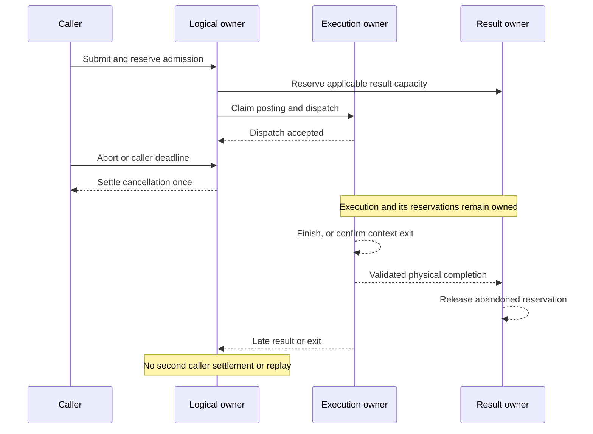

# Execution and ownership contract

Status: **proposed research contract**, 2026-10-21. Existing PJS behavior is the reference; this document introduces no public guarantee or accepted API. [Assessment and source identities](architecture-assessment.md) · [Roadmap](../roadmap.md) · [Decisions](../decisions.md).

## Execution identity

An existing PJS task handle identifies a module export. Its executable code is imported into each worker; the caller's closure, heap objects and globals are not transported as executable state. A task may return a promise, but it must finish task-owned asynchronous activity before returning. Module globals may persist across invocations within one worker. Tasks are trusted application code, not a sandbox for hostile code.

A future executor must name what it executes:

| Kind            | Executable and owner                                                    | What it cannot imply                                                                 |
| --------------- | ----------------------------------------------------------------------- | ------------------------------------------------------------------------------------ |
| Host JS         | Registered module export in a host worker/heap                          | Arbitrary caller closures or shared object identity across heaps                     |
| Native kernel   | Identified precompiled Rust/native function over validated owned values | Execution of an arbitrary registered JS function                                     |
| Compiled subset | Compiler-produced code with a documented semantic profile               | Universal JS compatibility or preservation of unsupported side effects               |
| Embedded JS     | Module/source interpreted or compiled by a separately embedded engine   | Node/DOM APIs, npm native dependencies, or host-heap access without explicit bridges |
| Wasm kernel     | Wasm module instantiated with declared host imports                     | Thread creation, JS compilation, or a complete host environment                      |

The native binding creates JS values and settles promises on the owning environment thread. Native compute receives owned native data. [napi-rs AsyncTask](https://napi.rs/docs/concepts/async-task) illustrates this split; a thread-safe callback schedules JS delivery and is not a second JS execution thread. Environment identity must be tracked per addon instance; a process-global reference must never be reused across unrelated workers/environments.

## Ownership invariants

These are owner-required constraints and are consistent with inspected PJS [ADR 0021](https://github.com/Miskovy/parallel-javascript/blob/72335494704a6251c26505226c4f2575424ab190/docs/adr/0021-physical-execution-containment.md) and [R3 inventory](https://github.com/Miskovy/parallel-javascript/blob/72335494704a6251c26505226c4f2575424ab190/docs/research/r3-memory-resource-qualification.md):

1. Caller settlement and physical execution completion are separate facts. Settle an accepted caller at most once; a late result cannot replace an earlier cancellation/error.
2. End physical ownership only on validated completion of the correlated execution, or confirmed exit of its execution context. Failure notification, a deadline, a requested stop, and an empty logical task map are insufficient.
3. No implicit replay, rollback, or restoration of transferred input. Replacement restores capacity, not application work or state.
4. Admission, payload retention, result credit, delivery and environment cleanup each have one authority and a recorded release boundary.
5. Successful shutdown proves the applicable physical and callback lifetimes have ended. Failure to stop must not be reported as success.

The existing protocol validates worker identity/state, correlation, start-before-result, final response kind, and batch item coverage/order. A future native completion event needs equivalent provenance: environment generation, execution ID, final status and validated result representation. A panic, request to cancel, or untrusted callback cannot manufacture completion. Do not turn raw native pointers into public execution IDs.



### Owners and release boundaries

| Resource                           | Authority                                                       | Normal release                                                                                | Cancellation/partial-failure rule                                                                                                   |
| ---------------------------------- | --------------------------------------------------------------- | --------------------------------------------------------------------------------------------- | ----------------------------------------------------------------------------------------------------------------------------------- |
| Admission slot / queued input      | Host dispatcher and task coordinator                            | Dispatch consumes queue entry; posting completion clears host input                           | Queued cancellation removes entry; no hidden native queue may escape admission accounting                                           |
| Transfer intent                    | Host task coordinator                                           | Hold through posting; release claim after posting returns                                     | Before posting, attachment remains; successful transfer is irreversible; reentrant abort during posting cannot release intent early |
| Native input/scratch               | Native invocation owner                                         | Kernel returns and all readers/helpers finish                                                 | Caller cancellation does not free active data; stop confirmation includes owned helper threads                                      |
| Physical slot                      | Execution adapter                                               | Validated final event or confirmed context exit                                               | Failed/terminating execution still occupies capacity; replacement waits for proof                                                   |
| Result reservation                 | Host result owner                                               | Maximum reservation reconciles only on deliverable success; actual credit lasts through yield | Queued release immediate; active abandoned work holds reservation until physical end; no invented refund on abnormal end            |
| Result backing                     | Native result owner, then binding/delivery owner, then consumer | Exactly one explicit ownership handoff at each boundary                                       | Conversion failure drops still-owned native result; queued delivery failure cannot leak or double-free it                           |
| Stream buffer/waiter               | Host stream owner                                               | Delivery releases buffer and credit; final delivery completes parent                          | Close/throw/error drops buffered results and settles waiter; active sibling execution remains separately owned                      |
| Parent factory/outputs             | Host range owner                                                | Terminal transition clears factory, output assembly, declarations and listeners               | Store terminal state before cancelling siblings; no further factory calls after terminal transition                                 |
| JS reference / callback queue item | Binding's environment owner                                     | Release on correct environment after completion or explicit disposal                          | Teardown rejects new sends; queued items must be destructible even when JS cannot run                                               |
| Worker/thread/context              | Pool or native execution owner                                  | Shutdown awaits real termination/join and pending cleanup                                     | Stop intent alone releases nothing physically owned; no successor starts before required exit                                       |

Result credit bounds declared visible output bytes, not allocations. A small view can retain a large backing buffer; copies, scratch, queue inputs, worker heaps, native allocator retention and consumer-held outputs need separate accounting. A future native queue needs explicit count/byte limits and one admission authority; duplicating an unbounded native queue behind PJS's bounded FIFO is unacceptable.

Existing range/stream semantics remain the reference: host factories are lazy and reentrant, batches execute their items sequentially, map assembly validates shape/cardinality, streams yield in completion order and start eagerly. An abandoned unclosed stream can block graceful drain. Existing input transfer lists are rejected for batch size greater than one. A native backend must either qualify these modes or reject them before factories/ownership changes; it cannot partially emulate them under the same public promise.

## Value and lifetime boundary

**Proposed first native profile:** copied, fixed-length, non-shared numeric/byte inputs and copied outputs, with explicit scalar parameters. Validate typed-array kind, byte offset, visible length, alignment where needed, integer overflow, allocation limits and detached state. Reject SharedArrayBuffer, resizable backing, arbitrary object graphs, accessors/proxies and JS callbacks for that profile. This bounded profile is an experiment restriction, not a restriction on existing PJS JS tasks.

Copy the visible slice while its host access is valid, then let native work own its allocation. A JS reference can keep a value reachable, but does not make it immutable, untransferable, unresizable, or safe to borrow concurrently. Rust `Send`/`Sync` constraints cannot prove rules enforced outside Rust. Native work must not retain an ordinary Rust borrow of mutable JS memory across an asynchronous return.

| Mechanism              | Required contract before any later optimization                                                                                                                                                                                                                  |
| ---------------------- | ---------------------------------------------------------------------------------------------------------------------------------------------------------------------------------------------------------------------------------------------------------------- |
| Copy                   | Define snapshot time, visible slice versus backing, size cap and failure cleanup. Account for both original and copy; synchronous ingress copying can itself harm responsiveness                                                                                 |
| Transfer               | Define eligible buffers, detachment point and sole new owner. Holding a reference or extracting a pointer is not transfer. A crash/cancellation never reattaches the original. Node Worker transfer does not automatically implement a native ownership transfer |
| Shared access          | Define mutability, synchronization, aliases and lifetime through physical completion. Shared readonly is a usage contract in current PJS; a safe native interface cannot rely on that phrase to create an unchecked immutable Rust reference                     |
| Reference/pinning      | Rooting controls GC reachability; pinning requires an actual engine/storage guarantee. Neither is an exclusivity lock. Resizing, detaching and concurrent host mutation must be excluded or handled                                                              |
| External native output | Requires a single deallocator owner and a host-supported finalization mechanism; test adoption/conversion failure and teardown. Defer this zero-copy optimization until copied output is qualified                                                               |
| Finalizer              | Last-resort reclamation of already inactive objects, not a deadline or a shutdown protocol. It must not free live inputs or depend on a callback that the same blocked JS thread must execute                                                                    |

Node-API documents environment cleanup and finalization, including thread-safe delivery cleanup when a JS call is no longer possible. The binding must stop admission, mark the environment closing, request cooperative stop, dispose queued deliveries, await native ownership termination through supported cleanup facilities, then release environment-local handles. Completion must not dereference a destroyed environment. [Node-API lifecycle and thread-safe delivery](https://nodejs.org/api/n-api.html).

Partial failure must be transactional only for internal bookkeeping, never for application effects. If validation fails, no execution is admitted. If input allocation fails, drop partial allocations and release admission. If dispatch fails before acceptance, release the unposted reservation. If execution might have started, retain physical ownership until proof. If result conversion fails after native return, free native output and report a conversion error once. If delivery is queued when the environment closes, free the queued item without requiring JS. Never depend on a finalizer arriving promptly.

## Cancellation, containment, and failure

Current ordinary abort/timeout settles callers without cooperative task polling. Current experimental execution leases initiate Node Worker termination after successful posting; `forceAfter` initiates shutdown escalation. They do not promise hard real-time deadlines, safe rollback, or bounded termination of arbitrary native calls. Preserve that precise scope rather than exaggerating existing containment.

| Event                                                       | Required behavior / backend consequence                                                                                                                                                                                                             |
| ----------------------------------------------------------- | --------------------------------------------------------------------------------------------------------------------------------------------------------------------------------------------------------------------------------------------------- |
| Queued cancellation                                         | Remove before dispatch, release undispatched input/result claims, settle once; no native kernel executes                                                                                                                                            |
| Active cooperative cancellation                             | Proposed native token polled at declared safe points; return an explicit cancelled outcome only after readers and helpers stop. Until then caller may already be settled                                                                            |
| Caller deadline                                             | Includes the declared acceptance/queue/delivery interval; timer delivery depends on host progress. It is not a command to free memory or kill a thread                                                                                              |
| Physical lease                                              | Host JS adapter retains current initiate-stop/confirm-exit distinction. Native in-process execution cannot advertise equivalent forced containment merely by setting a flag                                                                         |
| Rust panic with unwinding                                   | Catch at a reviewed native boundary if configured for unwind; drop task-owned values, mark completion only after cleanup, translate to a native-task failure. Check whether shared state is reusable; containment may require retiring the executor |
| Panic configured to abort                                   | Process termination, not a recoverable JS error. `catch_unwind` does not catch aborts                                                                                                                                                               |
| Segfault, undefined behavior, fatal allocator/process fault | May terminate/corrupt the whole process. Rust safety reduces certain bugs; FFI/native dependencies remain process risks. No promise settlement guarantee survives process loss                                                                      |
| Blocked/native noncooperative work                          | Safe arbitrary forced thread cancellation is unavailable. Keep resources owned; a watchdog can observe failure but cannot make freeing live memory safe                                                                                             |
| Task exception or serialization failure                     | Preserve error category and context, free only resources whose lifecycle ended; a normal JS exception can complete physical execution without killing the worker                                                                                    |
| Invalid/duplicate/stale result                              | Reject protocol event; it cannot release a different generation's slot. Initiate containment where supported, awaiting actual exit                                                                                                                  |
| Teardown with outstanding work                              | Reject new submissions; preserve memory until compute ends; no callback into a closing environment. Never block the JS thread waiting for a worker that waits for JS delivery                                                                       |
| Graceful shutdown                                           | Stop admission, finish accepted production/delivery according to profile, await physical completion and callbacks, then resolve once                                                                                                                |
| Forced shutdown request                                     | Host JS workers request termination; native cooperative execution requests stop and may remain pending. A changed shutdown guarantee needs explicit future API review                                                                               |

[Rust `catch_unwind`](https://doc.rust-lang.org/std/panic/fn.catch_unwind.html) distinguishes unwinding from aborting panics. [Rust thread documentation](https://doc.rust-lang.org/std/thread/) covers native thread lifetimes; [Tokio's blocking-task documentation](https://docs.rs/tokio/latest/tokio/task/fn.spawn_blocking.html) explicitly warns that running blocking work cannot generally be aborted. Do not allow a panic to unwind across an incompatible FFI boundary.

**Compatibility decision required:** an optional in-process native profile is not yet eligible to substitute for the existing runtime. It must either provide the required contract, reject unsupported lease/forced-shutdown requests before admission under a separately reviewed API, or execute inside a separately killable process. Native work spawned outside a JS worker's lifetime is not proved dead merely because that JS worker exits. A child process can contain many native crashes/hangs, but only confirmed child exit ends its physical owners; shared writes, external effects and transferred data are not rolled back. OS termination latency remains observational, not hard real time.

Recovery creates a fresh generation and obeys a bounded restart policy. No bootstrap/import failure loop, no transparent task replay, and no claim that shared application state is restored. Ordinary errors must identify task, execution/context, operation/partition where relevant, category, message and available remote stack/cause. Preserve current public error classes for current paths; new native/compiler categories require review. Do not leak pointers or payload contents into routine diagnostics.

## Bundling versus compilation

Bundling resolves a module graph and emits modules/entrypoints; TypeScript normally erases types and emits JS. Neither changes the executor into Rust. [TypeScript handbook](https://www.typescriptlang.org/docs/handbook/2/basic-types.html). A custom bytecode needs an interpreter/JIT and runtime semantics; choosing `.pjs` does not remove them. [AssemblyScript](https://www.assemblyscript.org/introduction.html) explicitly describes a TypeScript variant, so requiring it would conflict with ordinary JS/TS as the universal developer surface.

If later compiler research is reopened, begin with a bounded subset of **ordinary** JS/TS: exported pure functions over explicitly validated fixed numeric arrays and scalar values, finite loops, static helper imports, explicit bounds checks, and well-defined numeric operations. A subset narrows accepted programs; it must not silently redefine them. Code generation must account for JS double arithmetic, integer coercions/wrapping, typed-array stores, signed zero, NaN, infinity, bounds behavior and evaluation order. Rust `f32` intermediate arithmetic or unchecked indexing cannot silently replace JS Number semantics.

| Construct                  | General host JS path                                                                    | Proposed subset policy / obligation                                                                                        |
| -------------------------- | --------------------------------------------------------------------------------------- | -------------------------------------------------------------------------------------------------------------------------- |
| Closures                   | Module-local closures work within the worker; caller lexical environment is unavailable | Reject captures other than proven immutable compile-time constants; no serialization of caller captures                    |
| Static/dynamic imports     | Host resolver supplies dependencies; dynamic imports can fail at runtime                | Statically resolved allowlist only; reject computed/dynamic import until analyzed; report source location                  |
| Object identity/prototypes | Normal semantics within one worker; cloning already changes cross-heap identity         | Reject arbitrary objects, prototype mutation, Proxy, symbols, weak references and identity-dependent graphs                |
| Exceptions                 | Host engine executes `throw`/`try`/`catch`; PJS serializes final errors                 | Initially reject user exception constructs or compile a precisely documented subset; validation errors stay host-side      |
| Numbers                    | Host ECMAScript behavior                                                                | Differential cases for NaN, infinities, negative zero, rounding, overflow/coercions; no fast-math approximation by default |
| Promises/async             | Worker awaits task result                                                               | Reject initially; support would require job scheduling and async host contracts, not just a return type                    |
| Globals/host APIs          | Available only from chosen worker host                                                  | Reject time/randomness, filesystem/network, DOM, process, mutable globals and environment lookup                           |
| Native dependencies        | Host-specific loading and binary compatibility                                          | Reject opaque native imports; explicit approved intrinsic/kernel mapping only if semantics are specified                   |
| Side effects               | May occur and survive cancellation/failure                                              | Reject externally visible effects; no automatic deoptimization/replay after side effects                                   |

Compilation must select its path before execution. An unsupported program either produces a build error or uses an explicitly configured host-JS fallback selected at build/load time. A compiler bug, trap, cancellation, or native failure is never permission to retry as JS. General JavaScript compilation is a language/runtime project involving dynamic dispatch, object model, GC, exceptions, jobs and host APIs; it is rejected as the current direction. A subset succeeds only if representative developer tasks qualify with acceptable diagnostics and without disguised adoption of a new language.

## Artifact and build workflow hypothesis

**Proposed, not implemented:** optional preparation may read explicit task entries from `package.json` or a small configuration file. Pick one source of truth and diagnose conflicting entries; do not require both. Existing direct registration remains sufficient for simple Node tasks. The first likely output is an inspectable manifest beside ordinary JS modules and source maps. A `.pjs` extension or archive is optional packaging, not an executable format decision.

The manifest could describe a schema version, task ID, module URL relative to the deployed artifact, export name, executor kind, semantic profile, target capabilities, dependency identities/hashes, generated type/source-map references and producer version. A native/Wasm variant would additionally identify the kernel/artifact and ABI/import requirements. A plain JS variant contains no native code and is executed by a host worker. Embedded-engine bytecode, if ever allowed, must state the exact engine/build compatibility and remain an engine responsibility.

```text
PROPOSED WORKFLOW — no CLI or schema exists
ordinary task source + explicit entry configuration
  -> existing TS transpilation/bundling as needed
  -> optional static dependency validation and manifest generation
  -> ordinary JS entry modules + source maps + manifest
  -> target adapter validates capabilities and deployment paths
  -> host worker imports module and verifies export at startup
```

Do not execute task modules at build time to guess capabilities: imports can have side effects. Static analysis cannot prove the behavior of every dynamic dependency; mark unresolved edges, require declarations where useful, and retain runtime startup validation. Changing the current `file:` registration rule for browser URLs requires an explicit API decision. Generated types improve discoverability but do not validate runtime inputs or prove compiled-subset membership.

Cache keys should include normalized source/dependency hashes, tool version, target profile and compilation options; no absolute developer paths in deployable artifacts. Preserve readable JS and source maps for debugging. Validate schema and executor before loading. Prefer standard package integrity and deterministic builds over a custom signing/container system. No downloaded code is made trustworthy by a manifest hash alone. Ownership and shutdown rules apply equally to artifact-loaded tasks.

## Qualification obligations

Future evidence must observe logical task maps, physical executions, live threads/contexts, admission, transfers, result reservations, buffers, environment references and callback queues independently. A single `pending === 0` assertion is insufficient. Use controlled event histories plus real exit/teardown cases, retaining source/host identities and failing histories. Include cancellation during ingress, delayed physical completion, late/duplicate completion, conversion failure, shutdown during startup, panic, closing environment with pending delivery, and noncooperative work under an external test watchdog. No such tests or prototypes were created or run in this planning task; bounded implementation units are in the [roadmap](../roadmap.md).
