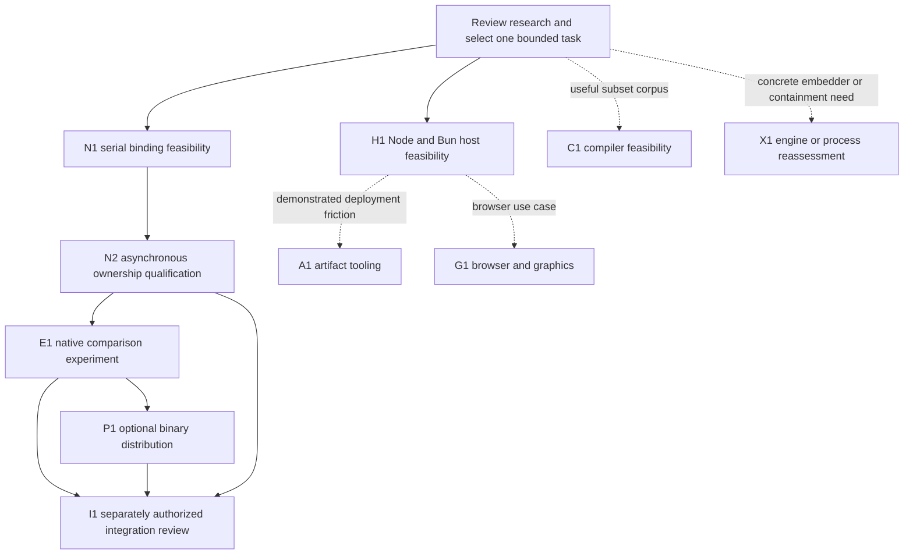

# Research roadmap and decision gates

Status: **proposed future work; none of these implementation stages has started**. Researched 2026-10-21. [README](../README.md) · [Architecture](research/architecture-assessment.md) · [Execution contract](research/execution-and-ownership-contract.md) · [Decision ledger](decisions.md).

The owner authorized this planning set only. Every implementation unit below requires a later assignment. Passing a prototype gate, completing a date-based milestone, or learning Rust does not authorize integration, a merge, or publication. PJS v1.0 stabilization remains independent.

## Dependency order and ownership

Owner names below are responsibility roles to assign, not invented personnel. The product owner approves product/compatibility choices; the runtime maintainer owns invariants; the binding maintainer owns host/native lifetimes; the qualification maintainer owns independent evidence; the packaging maintainer owns distribution; the tooling maintainer owns discovery/build/compiler work; the graphics maintainer owns renderer integration.

H1 can proceed independently of Rust. C1, G1, A1 and X1 are conditional branches, not requirements for completing N1 or native research. No general Rust runtime/core milestone is assumed.

## Bounded implementation units

### R0 — review before code

- **Purpose/scope:** confirm the distinction between host portability and native execution, select the first target and copied-value profile, and approve one task. Dependencies: this reference set; refresh PJS main and inspect S1 if it becomes available.
- **Owner:** product owner with runtime/binding maintainers. Interfaces affected: research decisions only. Excludes implementation and changes to stable support promises.
- **Evidence/acceptance:** record choices D2/D3/D4 in the ledger; name the experiment workload, failure profile and roles. Unresolved choices may stay deferred if the selected unit does not depend on them.
- **Compatibility/packaging/failure:** no production effect. **Go:** bounded assignment accepted. **No-go:** revise the proposal; leave v1.0 untouched.

### N1 — smallest next implementation task: serial native value boundary

**Recommended first Rust task, only after R0 review:** in a new isolated experimental workspace, expose one synchronous serial Rust kernel through napi-rs on Linux x64 GNU and one explicitly pinned supported Node 24 release. Use the 5×5 integer filter specified below. This learns ownership, slices, `Vec`, checked lengths, `Result`, FFI and generated declarations while testing a real data boundary. It does not yet test responsiveness or parallelism.

- **Purpose/dependencies:** establish whether a JS developer can call a prebuilt-style native operation with predictable validation, output and cleanup. Depends on accepted copied-input/output scope; choose and record Rust/napi-rs/Node-API versions before building.
- **Scope/interfaces:** one pure kernel module, one thin Node-API export, one JS call surface and generated declaration in the experimental workspace. Kernel receives owned input and scalar dimensions; returns owned output. No PJS facade, scheduler, worker adapter or registry modifications.
- **Explicit exclusions:** async execution, threads/pools, custom cancellation, transfer/shared borrowing, external zero-copy buffers, compiler, `.pjs` CLI, public package naming/publication, Bun support and performance claims.
- **Owner:** binding maintainer; runtime maintainer reviews ownership; owner can implement with senior review as a Rust learning unit.
- **Observable acceptance:** JS caller gets exact expected bytes for normal, empty and boundary fixtures; malformed dimensions, overflowing lengths, wrong views and unsupported backing reject before compute; copy input ownership is explicit; output does not alias input. Generated types match actual runtime input validation. Native failures cannot unwind through the FFI boundary.
- **Tests/evidence:** independent small hand-computed vectors plus differential serial-JS fixtures; offset views and detached input; invalid/oversized dimensions without exhausting memory; repeated success/error calls with exact allocation ownership checks. Record local build, source and toolchain identities. No throughput gate at N1.
- **Compatibility/packaging/failure:** experimental synchronous call can block JS and must be labelled accordingly. Maintainer Rust toolchain required; no end-user installation claim. Failures remain local to the experiment and do not alter PJS contracts.
- **Go/no-go:** proceed to N2 only if the copied-value boundary is comprehensible and correct. If binding cost or restrictions defeat the workload, revise representation or abandon native work. Retain the JS reference; do not generalize a successful binding into a runtime rewrite.

### N2 — asynchronous ownership and lifecycle qualification

- **Purpose/dependencies:** qualify physical ownership before parallel execution claims. Depends on N1. Scope: one bounded asynchronous execution facility, explicit queue capacity, cooperative stop token, environment-local state and deterministic cleanup of owned values.
- **Interfaces/owner:** experimental submit/completion/dispose boundary; binding maintainer owns environment teardown, runtime maintainer owns invariants. Choose one standard facility after reviewing whether napi-rs async work is sufficient; no new scheduler framework or nested pools.
- **Exclusions:** general JS callbacks, forced thread cancellation, engine embedding, PJS integration, transfer/shared input, and full range API parity.
- **Acceptance/evidence:** cancelled callers retain physical ownership until native return; queue overflow/queued cancel are exact; late completion settles no caller twice; environment close admits nothing and leaves no callbacks targeting dead state. Tests hold compute/completion independently, inject queue/conversion failures, close an environment with pending deliveries, check unwind cleanup and repeat create/dispose cycles. A deliberately blocked case runs only in a disposable test process with an external watchdog; it must demonstrate the limitation rather than claim safe thread killing.
- **Compatibility/packaging/failure:** a cooperative profile does not implement current execution leases or forced shutdown. Unsupported options must be explicitly rejected by a separately reviewed experimental interface. No native thread may outlive its owned data or silently survive environment disposal.
- **Go/no-go:** proceed only with exact lifecycle evidence. If teardown requires unsafe freeing, deadlocks, or unverifiable thread lifetime, stop; consider an explicit process profile only through X1.

### E1 — comparable computation experiment

- **Purpose/dependencies:** determine whether native acceleration has end-to-end value beyond binding feasibility. Depends on N2. Implement only the four comparison paths below, plus a declared native concurrency cap; use standard execution facilities with no custom allocator/scheduler.
- **Interfaces/owner:** experimental kernel driver, result validation and evidence files; qualification maintainer owns design and analysis, binding maintainer owns native execution. Excludes production APIs, universal JS compilation and graphics speedup claims.
- **Acceptance/tests:** exact useful outputs, independently conserved owners, clean successful shutdown, and frozen calibrated performance/footprint limits. Retain failures, raw trials and all configurations. Native parallel versus native serial attributes parallelism; native serial versus JS serial attributes language/toolchain/boundary effects. PJS comparison includes normal transport costs.
- **Compatibility/packaging/failure:** test binaries remain experimental. Any abort/crash/nontermination is a reported failure, not omitted from timings or automatically retried. The four paths need not have identical cancellation mechanisms; profile differences must remain visible.
- **Go/no-go:** pursue a product kernel only if the selected user outcome improves beyond measurement noise while footprint and lifecycle budgets pass. If copies/startup dominate or JS workers meet the need more simply, abandon or narrow native scope. A faster kernel does not pass C1.

### H1 — additional host feasibility, independently useful

- **Purpose/dependencies:** establish how much portability existing execution already permits. Depends on R0, not native success. Scope: one pinned Bun release alongside pinned Node versions, in an isolated source copy/check-out with its own evidence paths.
- **Interfaces/owner:** host-boundary inventory around module loading, Worker lifecycle, transfer markers, async context, yielding, clocks, UUIDs and binary inspection. Host maintainer owns adapter proposals; qualification maintainer owns comparison. Excludes modifications to stabilization, broad browser abstraction and scheduler migration.
- **Acceptance/tests:** real module import/startup failure, clone/detach/transfer reservation behavior, shared input retention after caller abort, correlated physical completion, actual exit before replacement, result credits, stream close, shutdown and async context. Include installed-package/deployment behavior. Document unsupported guarantees individually; do not call a successful import “Bun support.”
- **Compatibility/packaging/failure:** no new native dependency. Bun's development source and release docs are hypotheses to test on its actual binary. Missing diagnostics must not silently become fabricated values; context or containment differences require an API decision.
- **Go/no-go:** if contracts pass, propose a small adapter and explicit support matrix under a new assignment. If a required guarantee cannot be observed/provided, mark the host unsupported for that profile and report the missing facility; keep Node release work independent.

### P1 — optional distribution feasibility

- **Purpose/dependencies:** verify that native value survives installation/deployment costs. Depends on useful E1 results and N2 qualification. Scope: local package tarballs/prebuilt platform artifacts for a reviewed target list, using established napi-rs packaging facilities.
- **Interfaces/owner:** optional package loader, platform selection, manifest and generated declarations; packaging maintainer. Excludes publishing, registry identity changes, mandatory base dependencies and hidden install-time compilation/downloads.
- **Acceptance/tests:** clean installs consume the matching platform binary without Rust; base install/import loads no native artifact; missing optional dependencies and wrong ABI yield actionable failures or the preselected JS path. Test Linux GNU/musl separately if both are supported, plus each approved OS/architecture on actual systems; verify bundled/serverless asset placement, integrity and cold start. Retain reproducibility/provenance and dependency/license evidence.
- **Compatibility/failure:** an unavailable binary is detected before dispatch; a runtime crash is never grounds for JS replay. Generated loader behavior is reviewed rather than assumed correct for every package manager.
- **Go/no-go:** add only tested targets meeting calibrated download/install/startup budgets. Reduce supported targets or abandon distribution if costs outweigh useful gain.

### A1 — optional task preparation, only if deployment evidence warrants it

- **Purpose/dependencies:** remove demonstrated task-entry/deployment friction from H1 or a real application. Scope: configuration validation and ordinary JS entry/manifest/source-map generation using existing tooling; evaluate `package.json` before inventing a separate file.
- **Interfaces/owner:** task descriptor/manifest reader and build integration; tooling maintainer. Excludes native compilation, custom bytecode, runtime dependency on the CLI and executing user imports during discovery.
- **Acceptance/tests:** deterministic relative-path output, duplicate task detection, missing exports/dependency diagnostics, stale-cache invalidation and source-map usability; direct registration still works without preparation. Test one normal TS project and one deployed/bundled project.
- **Compatibility/packaging/failure:** schema/executor mismatch rejected before execution; `.pjs` name remains optional. No base install cost for tooling.
- **Go/no-go:** retain only if it reduces demonstrated steps/errors; otherwise document ordinary registration and remove the extra workflow.

### C1 — JS/TS compiler feasibility, deferred

- **Purpose/dependencies:** assess preservation of developer computations, not kernel speed. Reopen only after obtaining a representative task corpus and reviewing the [semantic table](research/execution-and-ownership-contract.md#bundling-versus-compilation). First bounded unit is a corpus classifier/static validator; no code generator until coverage justifies one.
- **Interfaces/owner:** source diagnostics and proposed semantic profile; compiler/tooling maintainer. Excludes new syntax/language requirements, general JS, dynamic imports, arbitrary objects/promises/host effects and transparent post-execution fallback.
- **Acceptance/evidence:** retained anonymized/owner-authorized source fixtures, an explicit coverage denominator, reasons/locations for every rejection, comparison with ordinary JS outputs for any later generated code, and diagnostics a JS/TS developer can act on. Product owner sets acceptable coverage after corpus review, before evaluating a compiler.
- **Compatibility/packaging/failure:** a compiler is an optional build dependency; compiled outputs identify their executor/imports. Invalid programs fail or select JS before execution; traps cannot trigger replay.
- **Go/no-go:** reject if useful coverage requires a new language, semantics drift, or a large runtime unjustified by the workload. Prefer host JS; a native-kernel win does not reopen this gate automatically.

### G1 — browser and graphics feasibility, deferred

- **Purpose/dependencies:** address a measured CPU preparation bottleneck in one browser application. Scope: module-worker loading/capabilities, existing loader-pool coordination, copy/transfer behavior and renderer ownership. Depends on a selected application and browser support contract, not necessarily Rust.
- **Interfaces/owner:** browser task URLs, adapter capability profile and asset-result delivery; graphics and host maintainers. Excludes `.node`, DOM/rendering in arbitrary workers, GPU acceleration claims, and replacement of existing decoder implementations without evidence.
- **Acceptance/tests:** compare existing loaders alone with any added preparation; measure phase-specific timing, frame/input latency, combined thread counts and memory; test page teardown, cancelled loads, transfer ownership, CSP and cross-origin isolation on/off. Browser termination evidence needs a reviewed contract because its API differs from Node's exit promise.
- **Compatibility/packaging/failure:** no forced shared-memory deployment headers for the copy path; optional Wasm and worker assets must be correctly served/cached. No renderer/GPU object serialized as a task input.
- **Go/no-go:** stop if bottleneck is network, upload, draw calls or GPU rather than eligible CPU work, or if an existing loader already solves it. Revise application/loader settings instead of adding a pool.

### X1 — engine embedding or separate process, conditional reassessment

- **Purpose/dependencies:** respond to a named host limitation or native containment requirement. Scope of the first unit is an updated cost/contract assessment and one selected mechanism; requires owner approval before an embedding/process prototype.
- **Interfaces/owner:** engine lifecycle/import/job/debugger contract or process IPC/exit contract; embedding maintainer and runtime maintainer. Excludes silently making a runtime/service mandatory and implementing all engine candidates.
- **Acceptance/evidence:** compare installed bytes, startup, memory, dependency coverage and debugging against host workers; demonstrate what interrupts stop and what needs actual process exit. Process evidence includes lost IPC, child crash, orphan cleanup and no replay. Engine evidence includes GC roots, promise jobs and native-import limits.
- **Compatibility/packaging/failure:** expose engine version/build and required assets, or packaged executable/supervisor behavior. A second engine is a runtime responsibility; process isolation does not undo external effects.
- **Go/no-go:** choose only if the identified requirement cannot be met more simply and deployment costs are accepted; otherwise retain host execution/cooperative kernel limits.

### I1 — possible production integration, separately authorized

- **Purpose/dependencies:** consider one independently useful optional feature after N2/E1/P1 or a qualified H1 outcome. Refresh exact PJS source and review S1 if available; no dependency on changing the v1.0 plan.
- **Interfaces/owner:** explicitly reviewed JS API/capabilities, backend loading and diagnostics; product owner plus API/runtime/release maintainers. Excludes automatic replacement of the stable backend or broad mechanical porting.
- **Acceptance/tests:** independent contract qualification at exact source/host/package identities; existing stable tests/qualification remain intact; new ownership/failure tests pass for every advertised capability. Document API/versioning changes and migration behavior; qualify installed artifacts and ensure the optional feature can be absent.
- **Compatibility/packaging/failure:** do not reuse historical R1/R2/R3 status as evidence for a new backend. Incompatible containment/ownership requires an explicit API/profile decision. Maintain a removal path through optional loading and the existing JS executor.
- **Go/no-go:** a reviewable proposal and separately authorized merge/release are required. Failure or cancellation of this research leaves Node PJS releasable.

## Future experiment specification

**Not executed in this task.** N1/N2 establish correctness before E1 makes performance comparisons.

### Candidate workload and falsifiable hypothesis

Use a deterministic **5×5 box filter over a one-channel linear-luminance Uint8Array tile**, an example of CPU asset/image preparation. For every output pixel, sum the 25 input samples using clamped-edge coordinates, divide by 25 with floor, and emit one byte. Each pass reads an immutable full input and writes a distinct full output. Keep pass count explicit and identical across paths. This is a numeric preprocessing instrument, not a claim about a Three.js loader or gamma-correct color image processing.

Hypothesis: for sufficiently substantial tiles, native execution may reduce useful-result time or host blocking enough to repay ingress/output copying, binding initialization and memory. Parallel native execution may improve throughput over serial native execution. Either can fail because the computation becomes memory-bandwidth limited, because JS JIT is effective, or because data conversion dominates. Dense output tests result costs that a scalar-only benchmark would hide.

Fixtures: empty and very small dimensions, non-square tiles, constant/ramp/impulse patterns, offset views and seeded random bytes. Initial size candidates: 256×256, 1024×1024 and 4096×4096, with one and several explicitly recorded passes. Pilot may adjust sizes to fit memory/measurement resolution before freezing the matrix. Preserve exact bytes and hashes, not only a PRNG seed. Reject malformed dimensions/lengths. The integer sum is at most 6375; exact output equality is required, so no tolerance can conceal numeric drift.

Use the same direct 25-sample algorithm and border rules initially. A separable filter, SIMD implementation, different cache tiling, or different pass fusion is a separately labelled optimization comparison; do not attribute an algorithm change to Rust or parallel scheduling. Disable unreviewed arithmetic approximations. A Rust-written kernel is a benchmark instrument; it proves neither ordinary JS compilation nor a requirement that users learn Rust.

### Comparison paths

| Path                            | What is timed and controlled                                                                                                                                                           |
| ------------------------------- | -------------------------------------------------------------------------------------------------------------------------------------------------------------------------------------- |
| Serial JS                       | Same function/algorithm on the host thread; includes normal output allocation. Records the responsiveness cost of blocking                                                             |
| Current PJS JS workers          | Same JS module and algorithm, partitioned into row ranges with identical halos; include input distribution, worker imports, output return and assembly                                 |
| Serial native through binding   | One native compute lane with the same ingress/output validation and copy representation; report direct synchronous N1 and, for responsiveness comparison, async one-lane N2 separately |
| Parallel native through binding | Same native kernel and representation, rows partitioned under explicit thread limit; include native queue, scratch and final assembly                                                  |

Use a one-worker PJS control and native worker counts of 1, 2 and up to the calibrated host cap; cap against available CPUs and memory, do not assume reported logical CPU count equals useful parallelism. No nested PJS/native pool in the primary comparison. Compare matching end-to-end outputs, including assembly where needed. PJS clone versus transfer versus shared input are separate transport arms if enabled; shared setup/copies, halo bytes, caller retention and output transfers are fully charged. Do not compare native pointer access against JS cloning and call the difference scheduling speedup.

### Timing and memory observations

Collect cold fresh-process and warm reused-runtime trials separately. Cold measurements include optional import/load, worker/native initialization, compilation/JIT effects, module imports and first useful output. Warm trials include queue wait, validation/conversion/copies, kernel execution, output conversion/transport, assembly and delivery. Also measure time to first usable tile and completion of the full image; they are different outcomes.

Observe host event-loop delay during each path, using an independent periodic progress probe and accounting for probe overhead. For later browsers, add animation-frame/input measurements rather than substituting throughput for responsiveness. Time cancellation-to-caller-settlement separately from cancellation-to-physical-release and full shutdown. Deliberately stalled consumers and queued/active aborts belong to lifecycle trials, not mixed into successful throughput averages.

Record process RSS, isolate heap/external/ArrayBuffer observations, native allocated bytes where available, live thread counts, peak input/scratch/output backing, and quiescent owner counts. Do not sum `arrayBuffers` with overlapping `external`, or treat process RSS sampled in a worker as that worker's private footprint. Measure application-retained and released outputs separately. Forced GC, if ever used diagnostically, is a separate labelled run and does not become a correctness requirement.

### Reproduction and statistical plan

Before acceptance trials, retain source SHA and dirty status for every path; exact Node/Bun/engine, Rust, napi-rs and dependency versions; compiler/linker target/flags and CPU features; OS/kernel/libc, machine CPU topology, RAM, power policy, affinity/container limits and concurrent system load. Record seeds, bytes/hashes, dimensions, pass count, grain, workers, queue and result capacities, transport mode, warmup policy, timer instrumentation and watchdog limits. Raw input/configuration, stdout/stderr, trial order, every sample and failure diagnostics must be retained in a new evidence directory, never overwritten.

Use a separate pilot to select sizes, repetitions, warmup and operational limits. Start planning with 30 independent fresh-process trials per cold cell and 30 independent process-level warm batches, each containing a fixed repeated workload; use pilot variance to freeze a feasible sample size before acceptance. Repeated invocations within one process are correlated and must not be counted as independent samples. Randomize or balance path order within machine/session blocks, retain the seed/order, and avoid concurrent comparison runs competing for CPUs.

Report medians, tails where sample size supports them, full distributions, and bootstrap confidence intervals over independent process/session units. Analyze drift, outliers and variance rather than dropping inconvenient trials. Predeclare exclusion rules for external machine failures; keep excluded observations with reasons. Repeat on another session and the intended deployment class before generalizing. Native faults, incorrect outputs and ownership leaks are failures even if fast.

### Acceptance criteria and calibrated budgets

Hard gates: exact output equality; no duplicate settlement/replay; no early physical release; bounded admission; correct unsupported-input handling; successful cleanup when execution returns; no dead environment access; no mandatory native dependency for base users.

The product owner and qualification maintainer must choose the target user outcome and **numeric** budgets after the pilot and before the acceptance campaign. Store budgets for cold first result, warm useful result, event-loop delay, throughput, download/installed size, startup memory, per-lane incremental memory, peak footprint and cleanup latency for cooperative work. Derive them from a representative application's time/memory/deployment constraints and observed noise. Unset budgets mean **inconclusive**, not pass. Freeze a minimum worthwhile absolute improvement and permitted regressions; no arbitrary universal speedup percentage is proposed here.

Go only if the confidence interval for the selected benefit clears the frozen meaningful-improvement margin and every required non-regression budget passes. Otherwise narrow the workload, revise the value boundary, or stop. Separate serial language/toolchain effects, parallel scaling and transport/queue overhead in the explanation. Native scheduling is justified only when the complete useful path benefits a real application and preserves its chosen contract.

## Three.js and WebGL scope

Official [DRACOLoader docs](https://threejs.org/docs/pages/DRACOLoader.html) recommend instance reuse; [KTX2Loader docs](https://threejs.org/docs/pages/KTX2Loader.html) describe Wasm transcoding and renderer format detection. At pinned Three.js dev commit `faaed9edfcdfb2426617c9fc9921b7a3b0c6a0c7`, [DRACOLoader source](https://github.com/mrdoob/three.js/blob/faaed9edfcdfb2426617c9fc9921b7a3b0c6a0c7/examples/jsm/loaders/DRACOLoader.js) owns a worker pool with default limit 4, transfers decode buffers and exposes `setWorkerLimit`; [KTX2Loader source](https://github.com/mrdoob/three.js/blob/faaed9edfcdfb2426617c9fc9921b7a3b0c6a0c7/examples/jsm/loaders/KTX2Loader.js) uses `WorkerPool`, sets a worker limit, posts transcoding work and disposes the pool. These are source observations, not measured application performance or promises for all releases.

| Stage                       | Likely owner / what a PJS experiment must separate                                                                                  |
| --------------------------- | ----------------------------------------------------------------------------------------------------------------------------------- |
| Network transfer            | Browser/network/cache/server; compression can reduce bytes while adding decode work. Scheduling CPU does not improve link bandwidth |
| Decode/transcode            | Existing DRACO/KTX2 workers/Wasm; measure their startup and queues before adding another pool                                       |
| CPU preparation             | Eligible array-based geometry/image work; candidate offload after profiling, with copy/transfer and dependency costs                |
| UI and scene work           | Application thread or explicitly designed render worker; DOM stays on its owner; scene objects are not arbitrary transferable data  |
| Draw-call overhead          | Renderer/application scene batching and material choices; more CPU workers do not remove draw calls                                 |
| Uploads and synchronization | Renderer/context owner submits resources; transferred CPU buffers are not already GPU-resident                                      |
| GPU execution               | GPU/driver/rendering workload; native CPU speedup does not imply GPU speedup                                                        |

A browser computation worker should return data suitable for the rendering owner to consume. A deliberately transferred OffscreenCanvas can support a render-worker architecture, but DOM access, input forwarding, resize handling and resource ownership must then be designed explicitly. The [HTML worker model](https://html.spec.whatwg.org/multipage/workers.html) is a different environment from a window and from Node. Do not move a live WebGL renderer/context or GPU resource between arbitrary workers by pretending it is a cloned JS object.

Account for combined DRACO, KTX2, PJS, Wasm and renderer workers. `hardwareConcurrency` is not permission for every library to allocate that many threads. Start with existing loader limits and one application-level concurrency budget; pool sharing is not assumed because loader protocols and ownership differ. Synchronization and queueing may erase CPU gains. An initial graphics study may conclude that reusing loaders, reducing pool limits, scheduling uploads or changing assets is sufficient; that is a valid result without Rust integration.

## Rust learning alongside bounded work

Keep learning tied to each reviewed stage: N1 covers ownership and explicit value conversion; N2 covers thread safety, cancellation and lifetimes; P1 covers target/ABI/toolchain distribution. Read the official [Rust thread documentation](https://doc.rust-lang.org/std/thread/) and [panic boundary documentation](https://doc.rust-lang.org/std/panic/fn.catch_unwind.html) together with napi-rs examples. Explain the invariant behind each owned allocation and error path during review. Do not use a learning objective as justification for a custom allocator, container, executor, or compiler. Application developers continue using JS/TS even if Kopos maintainers learn and write Rust.
